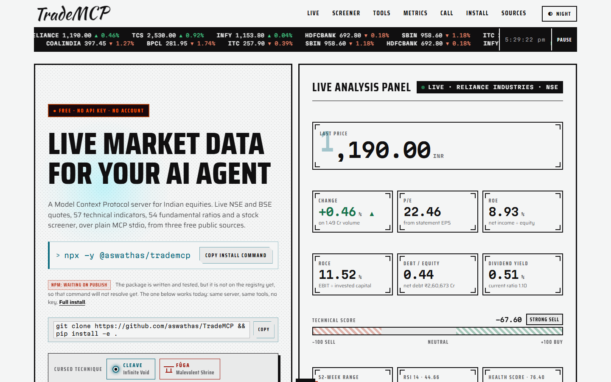
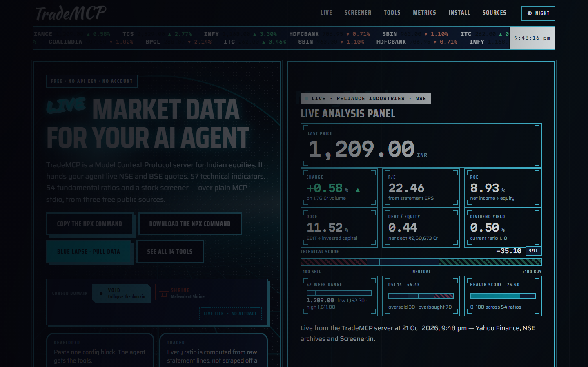
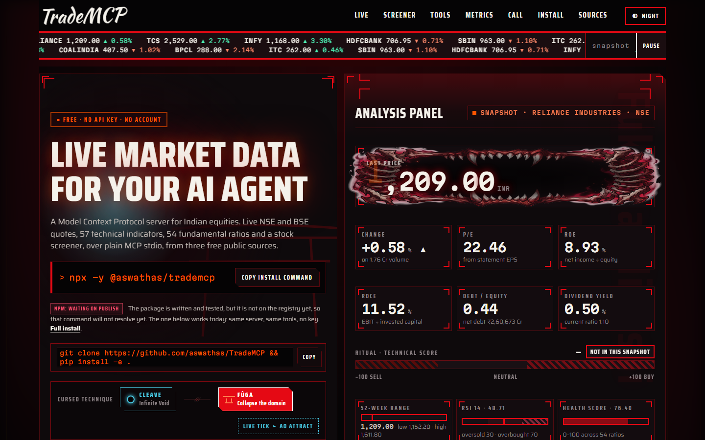
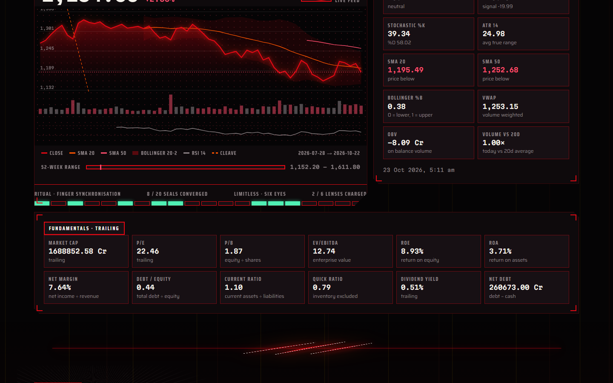
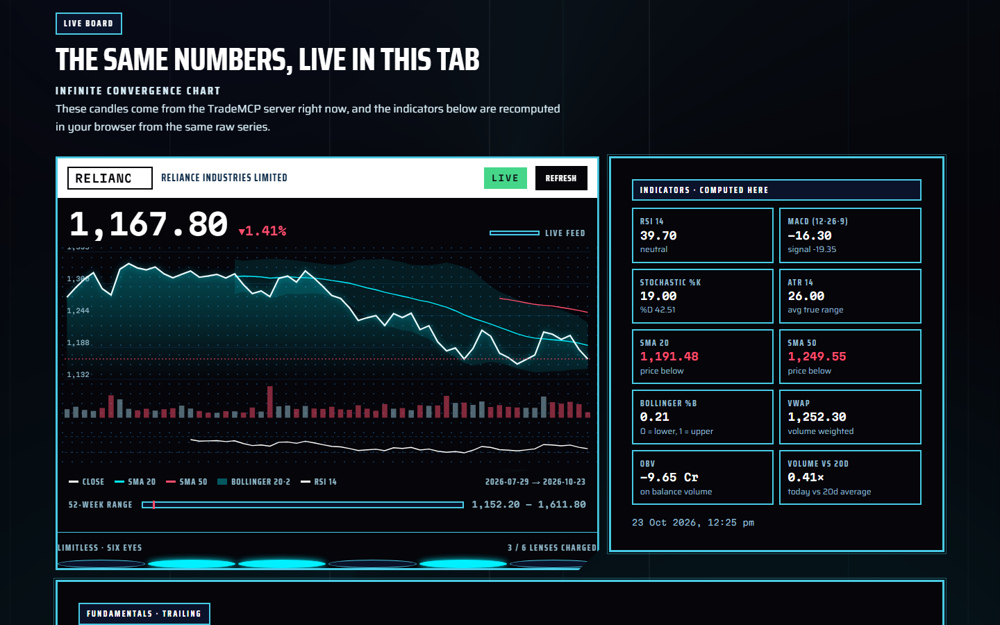
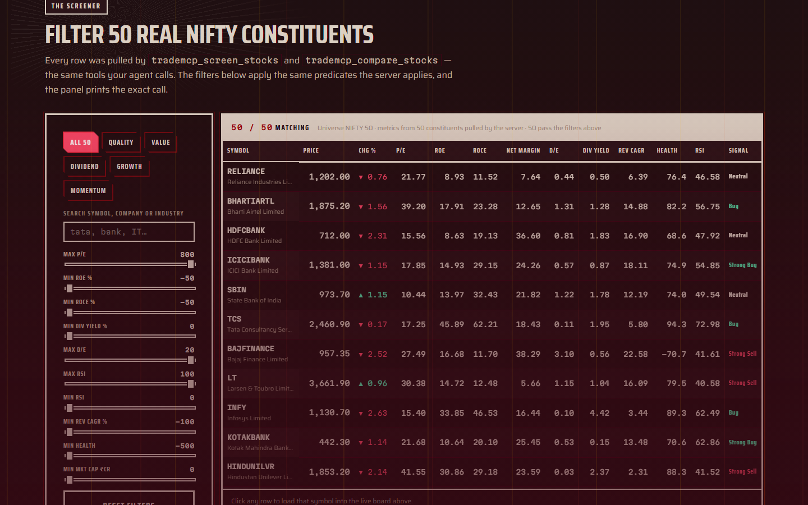

# TradeMCP — Indian Market Intelligence MCP Server

A free [Model Context Protocol](https://modelcontextprotocol.io) server for Indian equities (NSE/BSE).
It gives an AI agent **14 tools** covering live quotes, OHLCV history, **57 technical indicators**,
**full fundamental ratios**, financial statements, screeners and portfolio analytics.

**No API keys. No paid subscriptions. No account.** Every number comes from free public endpoints.

**Live demo → [aswathas.github.io/TradeMCP](https://aswathas.github.io/TradeMCP/)**

---

## Showcase

A demo page that runs the real server. Every figure on it is the server's own output — the live
board recomputes indicators in the browser from the same raw candles the server returned.

<table>
<tr>
<td width="33%"></td>
<td width="33%"></td>
<td width="33%"></td>
</tr>
</table>

<table>
<tr>
<td width="33%"></td>
<td width="33%"></td>
<td width="33%"></td>
</tr>
</table>

Run it locally — the page calls `/api/*` on that server, which calls the MCP tools themselves:

```bash
pip install -e .
python scripts/serve_showcase.py --port 8099
# → http://127.0.0.1:8099/
```

The hosted demo is the same page without a backend, so it falls back to the bundled snapshot and
labels itself **SNAPSHOT** on screen. Running the server locally is what makes it live.

To republish the demo after changing `showcase/site`:

```powershell
.\scripts\deploy_pages.ps1
```

That copies `showcase/site` onto the `gh-pages` branch, which is what GitHub Pages serves. The
branch is a build artefact — `showcase/site` stays the single source of truth.

---

## Free data sources

| Source | Used for | Why it works without a key |
|---|---|---|
| Yahoo Finance `chart` / `quote` / `fundamentals-timeseries` | prices, volumes, quotes, statements, trailing ratios | Public endpoints; the quote/summary APIs only need a free cookie+crumb handshake, done automatically |
| NSE India static CSV listings (`nsearchives.nseindia.com`) | symbol universe, company names, ISIN, industry | Static files, not behind the bot protection that guards NSE's live JSON API |
| Screener.in | India-specific ratios: ROCE, ROCE, promoter/FII/DII holding, working-capital days | Public company pages, parsed defensively and treated as optional |

All ratios are **computed locally** from the raw statement lines rather than copied off a screen, so the
numbers are consistent and auditable.

---

## Install

One command. The npm package carries the Python server and builds its own environment on first
run, so all you need is Node 18+ and Python 3.11+:

```bash
npx -y @aswathas/trademcp
```

Point your MCP client at it — Claude Code:

```bash
claude mcp add trademcp -- npx -y @aswathas/trademcp
```

Claude Desktop, Cursor, Windsurf, VS Code — in `mcpServers`:

```json
{
  "mcpServers": {
    "trademcp": {
      "command": "npx",
      "args": ["-y", "@aswathas/trademcp"]
    }
  }
}
```

Or run it from source:

```bash
git clone https://github.com/aswathas/TradeMCP.git
cd TradeMCP
python -m venv .venv
.venv\Scripts\activate          # Windows
source .venv/bin/activate       # macOS / Linux
pip install -e .
```

**First run takes about half a minute.** The npm package carries the Python server and builds its
own environment (a virtualenv with `mcp` and `httpx`) the first time it runs. After that the server
starts in about a second. If your MCP client has a short start-up timeout, install the package once
globally so the build happens at install time, then point the client at the `trademcp` command:

```bash
npm i -g @aswathas/trademcp
```

```json
{ "mcpServers": { "trademcp": { "command": "trademcp" } } }
```

Or run the helper script:

```powershell
.\scripts\install.ps1            # Windows
```

```bash
./scripts/install.sh             # macOS / Linux
```

Requires Python 3.11+. Only two third-party packages: `mcp` and `httpx`.

---

## Connect to your MCP client

### Claude Desktop

`%APPDATA%\Claude\claude_desktop_config.json` (Windows) or
`~/Library/Application Support/Claude/claude_desktop_config.json` (macOS):

```json
{
  "mcpServers": {
    "trademcp": {
      "command": "C:\\Users\\aswat\\Downloads\\Projects\\TradeMCP\\.venv\\Scripts\\python.exe",
      "args": ["-m", "trademcp"]
    }
  }
}
```

### MiniMax Code (MCode)

```json
{
  "mcpServers": {
    "trademcp": {
      "command": "C:\\Users\\aswat\\Downloads\\Projects\\TradeMCP\\.venv\\Scripts\\python.exe",
      "args": ["-m", "trademcp"]
    }
  }
}
```

### Cursor / VS Code / Windsurf

Same `mcpServers` block in `~/.cursor/mcp.json` or `.vscode/mcp.json`.

> Replace the `command` path with your own. If you installed with `pip install -e .` globally,
> `"command": "trademcp"` and `"args": []` also works.

---

## The tools

All tools are read-only, accept `response_format` (`markdown` default, or `json`), and take an NSE
symbol **or a company name** (`"RELIANCE"`, `"tata motors"`, `"NSE:TCS"`, `"RELIANCE.NS"`, an ISIN, or an index alias).

### Market

| Tool | What it does |
|---|---|
| `trademcp_search_symbol` | Search NSE listings by ticker or company name → code, name, ISIN, series |
| `trademcp_get_quote` | Last price, day change/range, volume, 52-week range & position, market cap, P/E, P/B, EPS, dividend yield, beta, 1w/1m/3m/6m/1y returns |
| `trademcp_get_price_history` | OHLCV candles (1d→1mo, 5m→1mo intraday) + period return, high/low, volume |
| `trademcp_get_index_snapshot` | NIFTY 50, SENSEX, 11 NIFTY sector indices, INDIA VIX |
| `trademcp_get_market_breadth` | Advancers/decliners, A/D ratio, average & median move, top gainers/losers, % above 200-DMA |
| `trademcp_compare_stocks` | 2–5 stocks side by side: price, valuation, ROE, margin, D/E, CAGR, health score, technical score |

### Technical

| Tool | What it does |
|---|---|
| `trademcp_get_technical_indicators` | Any of **57** indicators with recent values |
| `trademcp_get_technical_analysis` | Every indicator scored into signals + composite **Strong Buy → Strong Sell**, risk stats (volatility, Sharpe, Sortino, max drawdown, beta, alpha, relative strength), candlestick patterns |
| `trademcp_get_support_resistance` | 5 pivot styles (classic, Camarilla, Fibonacci, Woodie, DeMark), Fibonacci retracements, swing highs/lows, Donchian channels, ATR, 52-week range position |

**Indicators covered** — trend: SMA 20/50/200, EMA 9/21/50/200, MACD, ADX/+DI/−DI, Supertrend, Parabolic SAR, Ichimoku (Tenkan/Kijun/Senkou), Aroon, Vortex, linear slope ·
momentum: RSI 7/14, Stochastic %K/%D, StochRSI, CCI, Williams %R, MFI, ROC, CMO, TSI, Ultimate Oscillator, Awesome Oscillator ·
volatility: ATR, Bollinger (+%B, bandwidth), Keltner, Donchian, historical volatility, z-score ·
volume: OBV, VWAP, Chaikin Money Flow, Accumulation/Distribution, Price-Volume Trend, Force Index, volume ratio ·
candles: engulfing, hammer, inverted hammer, shooting star, doji (dragonfly/gravestone), harami, piercing line, dark cloud cover, morning/evening star, three white soldiers, three black crows, marubozu, tweezer top/bottom.

### Fundamentals

| Tool | What it does |
|---|---|
| `trademcp_get_fundamentals` | Valuation, profitability, leverage, liquidity, growth, DuPont, **0–100 health score**, India-specific ratios (ROCE, ROCE, promoter/FII/DII holding, debtor/inventory/payable days, cash conversion cycle) |
| `trademcp_get_valuation` | Focused valuation sheet + plain-English cheap/expensive read + optional peer comparison |
| `trademcp_get_financial_statements` | Income statement, balance sheet and cash flow, annual or quarterly |

**Ratios computed:** P/E · P/B · P/S · EV/EBITDA · EV/Sales · PEG · dividend yield · EPS · book value/share ·
gross/operating/EBITDA/net margin · ROE · ROA · ROCE · ROIC · asset turnover · equity multiplier · effective tax rate ·
debt/equity · debt/assets · net debt · net debt/EBITDA · interest coverage · debt/capital ·
current ratio · quick ratio · cash ratio · working capital · FCF margin · CFO/net income · CFPS · FCFPS ·
revenue & net income YoY · revenue & net income 3/5-year CAGR · DuPont ROE.

### Screening & portfolio

| Tool | What it does |
|---|---|
| `trademcp_screen_stocks` | Scan NIFTY 50/100/500 or all NSE stocks on 10 fundamental filters + 4 technical filters, sorted and ranked (`sort_by` + `sort_order`) |
| `trademcp_analyze_portfolio` | Values positions, P&L, weights, sector concentration, per-holding signals, portfolio beta/vol/Sharpe/drawdown vs benchmark, and risk flags |

---

## Example questions

- *"Is Reliance a buy right now? Show me the technicals and the fundamentals."*
- *"Screen the NIFTY 50 for ROE above 15% and debt/equity under 0.5, sorted by market cap."*
- *"What are the support and resistance levels for SBI?"*
- *"Compare Infosys and TCS on valuation, growth and momentum."*
- *"How is my portfolio of 10 Reliance, 5 TCS and 20 Infosys positioned?"*
- *"What is today's market breadth in the NIFTY 50?"*

---

## Configuration

Every setting has a sensible default; override with environment variables.

| Variable | Default | Purpose |
|---|---|---|
| `TRADEMCP_TIMEOUT` | `30` | HTTP timeout in seconds |
| `TRADEMCP_CACHE_DIR` | `~/.cache/trademcp` | Disk cache location |
| `TRADEMCP_QUOTE_TTL` | `300` | Quote cache seconds (5 min) |
| `TRADEMCP_PRICE_TTL` | `900` | Price history cache seconds (15 min) |
| `TRADEMCP_FUNDAMENTALS_TTL` | `21600` | Fundamentals cache seconds (6 h) |
| `TRADEMCP_UNIVERSE_TTL` | `43200` | NSE listing cache seconds (12 h) |
| `TRADEMCP_PROFILE_TTL` | `86400` | Screener.in profile cache seconds (24 h) |
| `TRADEMCP_MAX_CONCURRENCY` | `8` | Parallel upstream requests |
| `TRADEMCP_ENABLE_SCREENER_IN` | `1` | Set to `0` to skip Screener.in entirely |
| `TRADEMCP_USER_AGENT` | browser UA | Outbound User-Agent |

Caching keeps repeat screener and quote calls off the free endpoints. Delete the cache directory to
force a refresh.

---

## Verify it works

```bash
python scripts/verify_all_tools.py    # calls all 14 tools against live data
python -m pytest tests -q             # 70 offline unit tests
```

---

## Known limits

- **Prices are delayed** — Yahoo serves NSE quotes with a delay, not tick data. This is a research
  tool, not an order-routing system.
- **No intraday fundamental data** — statements update quarterly; the screener therefore reflects the
  last reported period.
- **Banks and financials** have no current ratio (they have no current-asset split), so that metric is
  blank for them by design, not by failure.
- **ROCE definitions differ.** TradeMCP computes ROCE as EBIT ÷ invested capital; Screener.in uses
  its own capital base, so the two figures differ slightly. Both are shown separately.
- **Screener.in is scraper-based.** If its markup changes, that source degrades to "fewer fields"
  rather than breaking the tool. Everything else keeps working.
- **Rate limits.** The free endpoints throttle. Requests are retried with backoff and cached, but a
  NIFTY 500 screen over cold cache takes roughly 30–60 seconds.

---

## Project layout

```
src/trademcp/
  app.py            MCPServer instance
  __main__.py       entry point (python -m trademcp)
  config.py         env-driven settings
  http.py           shared client: headers, retries, actionable errors
  cache.py          TTL disk cache
  symbols.py        symbol/name/ISIN/index resolution
  formatting.py     markdown + JSON rendering
  providers/        yahoo.py, nse.py, screener.py
  analytics/        indicators.py, fundamentals.py, signals.py
  tools/            market.py, technical.py, fundamentals.py, screener.py

showcase/
  site/             the static demo page
  screenshots/      the images above
  SPEC.md DEMO.md PROMPT.md
```

---

## License

MIT — see [LICENSE](LICENSE). Provided free of charge, with no warranty; it is a research tool, not
investment advice.
